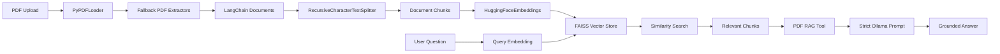
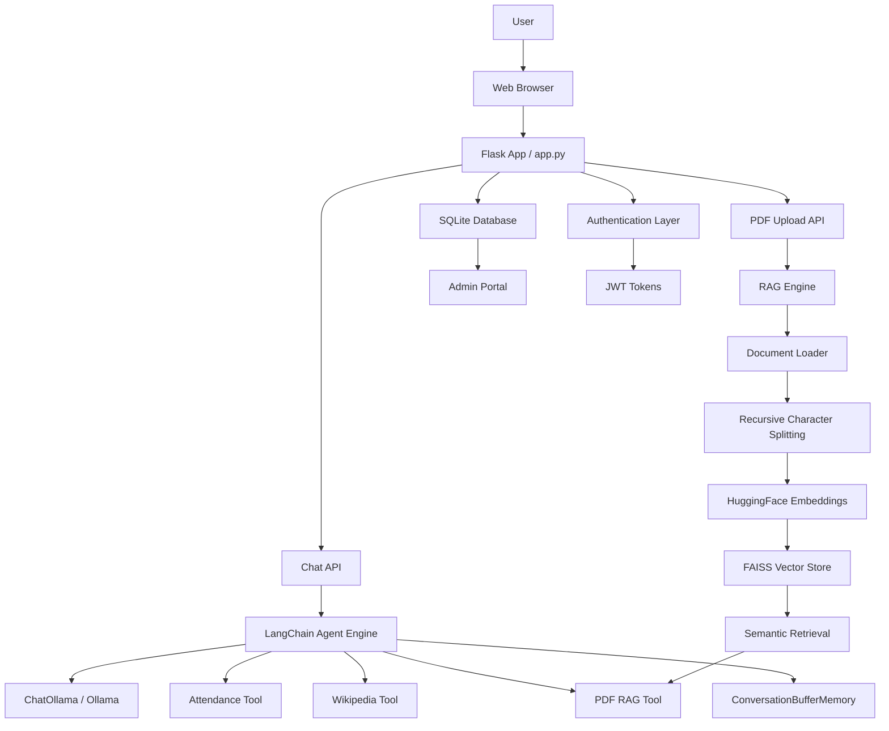

# Ollama LangChain RAG Assistant

A full-stack AI assistant built around local inference, document retrieval, and role-based access. The application combines a Flask web interface, Ollama-powered LLM orchestration, LangChain tools and memory, and a Retrieval-Augmented Generation (RAG) pipeline for answering questions from uploaded PDFs.

## Overview

This project is designed for private, on-device AI usage with a practical workflow:

- Users can register and log in through a secure authentication flow.
- An admin portal provides user management and role-based visibility.
- A chat interface can respond using local Ollama models.
- A PDF upload workflow builds a searchable vector index from the document.
- The assistant can answer document-grounded questions without relying on external AI APIs.
- LangChain tools support Wikipedia lookup, attendance calculation, and PDF document retrieval.
- LangChain conversation memory preserves context across chat interactions.

The application is well suited for educational, internal knowledge, and document-assistant scenarios where privacy and local execution matter.

## LangChain Features Used

This project uses LangChain to connect the local Ollama model with tools, conversation history, document processing, embeddings, and vector search.

### LangChain tools

The assistant exposes three custom tools using `langchain_core.tools.tool`:

1. **Attendance Calculator Tool** (`calculate_attendance_tool`)
   - Accepts attended classes and total classes.
   - Calculates the current attendance percentage.
   - Checks eligibility against the 75% requirement.
   - Calculates the number of consecutive classes needed to reach the target.
   - Calculates how many classes can be safely missed while remaining above 75%.

2. **Wikipedia Search Tool** (`wikipedia_search_tool`)
   - Searches Wikipedia for concepts, people, places, historical facts, and general information.
   - Returns the top article title, URL, and a concise summary.
   - Handles disambiguation and missing-page errors.

3. **PDF RAG Search Tool** (`pdf_rag_search_tool`)
   - Searches the currently uploaded PDF through the vector store.
   - Returns relevant document chunks together with their page numbers.
   - Provides document-grounded context to the Ollama model.
   - Prevents document questions from being answered when no PDF is loaded.

The `AgentEngine` routes user requests to the appropriate tool using intent detection. When a PDF is uploaded, strict PDF RAG mode takes priority so answers are generated only from the retrieved document context.

### LangChain conversation memory

Conversation history is implemented with LangChain's `ConversationBufferMemory` in `backend/memory_engine.py`.

- User messages and assistant responses are stored as LangChain chat messages.
- History can be retrieved as raw `HumanMessage` and `AIMessage` objects.
- The formatted conversation transcript is added to the prompt as context for later questions.
- Memory is used in both normal chat mode and strict PDF question-answering mode.
- The memory engine can be cleared when a new conversation should begin.

This allows the assistant to maintain conversational context while keeping the inference workflow local through Ollama.

## RAG Pipeline

The document question-answering workflow is implemented with LangChain document utilities, Hugging Face embeddings, and FAISS.



### RAG stages

1. **Document loading**: The uploaded PDF is loaded with `PyPDFLoader`.
2. **Fallback extraction**: If the primary loader cannot extract text, the application falls back to `pypdf` and `PyPDF2`.
3. **Text splitting**: `RecursiveCharacterTextSplitter` divides document pages into searchable chunks using configurable chunk size and overlap values.
4. **Embedding generation**: `HuggingFaceEmbeddings` converts each chunk into a normalized vector representation.
5. **Vector indexing**: FAISS stores the chunk embeddings for efficient similarity search.
6. **Query retrieval**: A user question is embedded and matched against the indexed document chunks.
7. **Context injection**: The most relevant chunks are returned by `pdf_rag_search_tool` and inserted into the Ollama prompt.
8. **Strict answering**: When a PDF is active, the agent instructs the model to answer only from the retrieved document context and to clearly state when the answer is not present.

The RAG engine also tracks the loaded file name, page count, chunk count, and vector-store state. The vector store can be reset when the uploaded document is removed or replaced.

## System Architecture



## Application Components

### 1. Frontend and API layer

- Flask server exposes the user interface and REST APIs.
- Authentication is handled with JWT-based login and registration.
- The app supports both user chat and admin operations.

### 2. Agent orchestration layer

- The agent engine determines the best action based on the prompt.
- It chooses among:
  - PDF-grounded retrieval
  - Attendance calculation
  - Wikipedia lookup
  - General conversation through Ollama
- Tool results are added to the model prompt before the final response is generated.

### 3. Large language model layer

- `ChatOllama` connects LangChain to local Ollama models.
- Model selection is configurable and can be switched at runtime.
- Conversation history is supplied through LangChain messages and memory.

### 4. RAG and document intelligence layer

- Uploaded PDF files are parsed and represented as LangChain `Document` objects.
- Documents are split into overlapping chunks.
- Each chunk is embedded with a sentence-transformer model.
- FAISS supports semantic retrieval of relevant passages.
- The system enforces strict PDF mode when a document is active.

### 5. Data and access layer

- SQLite stores user records and admin metadata.
- Roles separate ordinary users from administrators.
- Admin users can inspect and manage user records through a dedicated portal.

## Project Structure

```text
├── app.py                     # Flask application and API endpoints
├── auth.py                    # JWT utilities and access control
├── database.py                # SQLite database initialization and user management
├── config.py                  # Model configuration and system prompts
├── backend/
│   ├── agent_engine.py        # LangChain message routing and tool orchestration
│   ├── llm_engine.py          # Ollama model connection and runtime selection
│   ├── memory_engine.py       # ConversationBufferMemory handling
│   ├── rag_engine.py          # PDF ingestion, chunking, embeddings, and FAISS indexing
│   └── tools/
│       ├── attendance_tool.py # Attendance calculation LangChain tool
│       ├── pdf_rag_tool.py    # PDF retrieval LangChain tool
│       └── wikipedia_tool.py  # Wikipedia lookup LangChain tool
├── templates/
│   └── index.html             # Single-page web app interface
├── static/
│   ├── css/style.css          # UI styling
│   └── js/app.js              # Frontend logic
├── ui/                        # Optional desktop application using CustomTkinter
│   ├── main_window.py
│   ├── styles.py
│   └── components/
├── tests/                     # Backend and RAG validation tests
├── uploads/                   # Uploaded PDF storage
├── requirements.txt           # Python dependencies
├── README.md                  # Project documentation
└── .gitignore                 # Ignored workspace files
```

## How the Application Works

### User flow

1. A user registers or logs in.
2. The frontend requests a JWT token from the Flask server.
3. The user opens the chat panel and asks a question.
4. The agent checks whether a PDF is loaded.
5. If a PDF is attached, the app routes the question through the PDF RAG tool.
6. Otherwise, it detects whether the request requires the attendance tool, Wikipedia tool, or general chat.
7. The selected tool result and conversation history are provided to the Ollama model.
8. The final user message and assistant response are saved in LangChain memory.

### PDF RAG flow

1. A document is uploaded through the web app.
2. The PDF is saved in the uploads folder.
3. The RAG engine extracts text using `PyPDFLoader`, with `pypdf` and `PyPDF2` fallbacks.
4. The text is split into overlapping chunks with `RecursiveCharacterTextSplitter`.
5. `HuggingFaceEmbeddings` creates vector embeddings for each chunk.
6. FAISS indexes the chunks for semantic retrieval.
7. A user question is converted into a query embedding and matched against the indexed text.
8. Relevant content is returned by the PDF RAG LangChain tool.
9. The retrieved context is passed to Ollama with strict document-only instructions.
10. The assistant answers from the document or explains that the document does not contain the requested information.

### Admin flow

1. The default admin account is created during startup.
2. The admin logs in and accesses the dedicated management portal.
3. User details can be reviewed and filtered.
4. The admin view is separated from the main chat experience.

## Example Demonstration

### Login and chat

The app includes a secure login page. Users can either:

- log in to an existing account, or
- register a new account with a username, email, and password

Once logged in, the user can ask natural-language questions such as:

- What is the attendance percentage for 42 out of 50 classes?
- Search Wikipedia for machine learning.
- Explain the contents of my uploaded PDF.
- What did we discuss in my previous question?

### PDF-based query example

A typical workflow looks like this:

1. Upload a course handout or research document.
2. The assistant extracts, chunks, embeds, and indexes the document.
3. Ask: `What are the key conclusions mentioned in the document?`
4. The PDF RAG tool retrieves relevant chunks.
5. Ollama answers strictly from the retrieved document passages.

### Attendance example

The attendance tool can calculate:

- attended classes
- total classes
- attendance percentage
- eligibility against the 75% requirement
- required classes to reach the target
- safe bunking allowance while maintaining the target

Example input:

```text
I attended 38 classes out of 45.
```

This is interpreted by the attendance tool and converted into a useful summary with attendance percentage and threshold calculations.

## Quick Start

### Prerequisites

- Python 3.10 or newer
- Ollama installed locally and running
- A downloaded local model, such as `llama3.2`

Install a model with:

```bash
ollama pull llama3.2
```

### Clone the repository

```bash
git clone https://github.com/vignesh059/ollama-langchain-rag-assistant.git
cd ollama-langchain-rag-assistant
```

### Create a virtual environment and install dependencies

```bash
# Windows
python -m venv venv
venv\Scripts\activate

# macOS / Linux
python3 -m venv venv
source venv/bin/activate

pip install -r requirements.txt
```

### Run the application

#### Web interface

```bash
python app.py
```

Then open:

```text
http://127.0.0.1:5000
```

#### Desktop interface

```bash
python ui/main_window.py
```

## Default Credentials

### Admin account

- Username: `admin`
- Password: `adminpassword`

This account can access the admin users portal directly.

### User account

Create a new user account from the login screen if you want a regular non-admin session.

## Testing

Run the validation suite with:

```bash
python -m unittest tests/test_backend.py
python -m unittest tests/test_pdf_rag.py
```

These tests cover backend behavior and the RAG pipeline.

## Security and Privacy Notes

- The application uses local Ollama models for inference.
- PDF processing, embedding, and vector search are performed locally.
- No external AI API key is required for the standard private deployment.
- JWT tokens are used for session management.
- Document retrieval is restricted to the current uploaded document in strict mode.

## License

This project is open source and distributed under the MIT License.

## Summary

The project combines LangChain tool orchestration, local Ollama model inference, LangChain conversation memory, retrieval-augmented document question answering, and role-based user administration in a compact Python application. Its main AI workflow demonstrates how a local LLM can be extended with custom tools, persistent conversation context, and a complete PDF RAG pipeline.
