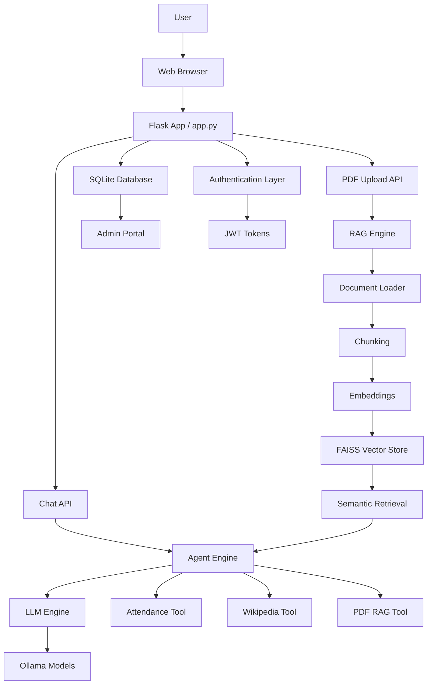

# Ollama LangChain RAG Assistant

A full-stack AI assistant built around local inference, document retrieval, and role-based access. The application combines a Flask web interface, Ollama-powered LLM orchestration, and a Retrieval-Augmented Generation pipeline for PDF question answering.

## Overview

This project is designed for private, on-device AI usage with a practical workflow:

- Users can register and log in through a secure authentication flow.
- An admin portal provides user management and role-based visibility.
- A chat interface can respond using local Ollama models.
- A PDF upload workflow builds a searchable vector index from the document.
- The assistant can answer document-grounded questions without relying on external APIs.
- The system supports domain tools such as Wikipedia lookup and attendance calculation.

The application is well suited for educational, internal knowledge, and document-assistant scenarios where privacy and local execution matter.

## System Architecture



## Application Components

### 1. Frontend and API layer
- Flask server exposes the user interface and REST APIs.
- Authentication is handled with JWT-based login and registration.
- The app supports both user chat and admin operations.

### 2. Agent orchestration layer
- The agent engine determines the best action based on the prompt.
- It chooses among:
  - PDF-grounded retrieval
  - attendance calculation
  - Wikipedia lookup
  - general conversation

### 3. Large language model layer
- The LLM engine connects to Ollama locally.
- Model selection is configurable and can be switched at runtime.
- Conversations can retain local memory for contextual responses.

### 4. RAG and document intelligence layer
- Uploaded PDF files are parsed and chunked.
- Each chunk is embedded with a sentence-transformer model.
- The FAISS vector store supports semantic retrieval of relevant passages.
- The system enforces strict PDF mode when a document is active.

### 5. Data and access layer
- SQLite stores user records and admin metadata.
- Roles separate ordinary users from administrators.
- Admin users can inspect and manage user records through a dedicated portal.

## Project Structure

```text
├── app.py                     # Flask application and API endpoints
├── auth.py                    # JWT utilities and access control
├── database.py                # SQLite database initialization and user management
├── config.py                  # Model configuration and system prompts
├── backend/
│   ├── agent_engine.py        # Message routing and tool orchestration
│   ├── llm_engine.py          # Ollama model connection and runtime selection
│   ├── memory_engine.py       # Conversation memory handling
│   ├── rag_engine.py          # PDF ingestion, chunking, and FAISS indexing
│   └── tools/
│       ├── attendance_tool.py # Attendance calculation logic
│       ├── pdf_rag_tool.py    # PDF retrieval wrapper
│       └── wikipedia_tool.py  # External knowledge lookup tool
├── templates/
│   └── index.html             # Single-page web app interface
├── static/
│   ├── css/style.css          # UI styling
│   └── js/app.js              # Frontend logic
├── ui/                        # Optional desktop application using CustomTkinter
│   ├── main_window.py
│   ├── styles.py
│   └── components/
├── tests/                     # Backend and RAG validation tests
├── uploads/                   # Uploaded PDF storage
├── requirements.txt           # Python dependencies
├── README.md                  # Project documentation
└── .gitignore                 # Ignored workspace files
```

## How the Application Works

### User flow
1. A user registers or logs in.
2. The frontend requests a JWT token from the Flask server.
3. The user opens the chat panel and asks a question.
4. The agent checks whether a PDF is loaded.
5. If a PDF is attached, the app resolves the question against the uploaded document context.
6. Otherwise, it routes to attendance, Wikipedia, or general chat logic.

### PDF RAG flow
1. A document is uploaded through the web app.
2. The PDF is saved in the uploads folder.
3. The RAG engine loads the document text from the PDF.
4. The text is split into manageable chunks.
5. Embeddings are created for each chunk.
6. FAISS indexes the chunks for semantic retrieval.
7. A user question is converted into an embedding and matched against the indexed text.
8. Relevant content is returned to the LLM, which answers strictly from the document.

### Admin flow
1. The default admin account is created during startup.
2. The admin logs in and accesses the dedicated management portal.
3. User details can be reviewed and filtered.
4. The admin view is separated from the main chat experience.

## Example Demonstration

### Login and chat
The app includes a secure login page. Users can either:

- log in to an existing account, or
- register a new account with a username, email, and password

Once logged in, the user can ask natural-language questions such as:

- What is the attendance percentage for 42 out of 50 classes?
- Search Wikipedia for machine learning
- Explain the contents of my uploaded PDF

### PDF-based query example
A typical workflow looks like this:

1. Upload a course handout or research document.
2. The assistant indexes the document.
3. Ask: "What are the key conclusions mentioned in the document?"
4. The assistant answers strictly from the retrieved document passages.

### Attendance example
The tool can calculate attendance metrics from values such as:

- attended classes
- total classes
- attendance percentage
- required number of future classes to maintain a threshold

Example input:

```text
I attended 38 classes out of 45.
```

This is interpreted by the attendance tool and converted into a useful summary with attendance percentage and shortfall calculations.

## Quick Start

### Prerequisites
- Python 3.10 or newer
- Ollama installed locally and running
- A downloaded local model, such as llama3.2

Install a model with:

```bash
ollama pull llama3.2
```

### Clone the repository

```bash
git clone https://github.com/vignesh059/ollama-langchain-rag-assistant.git
cd ollama-langchain-rag-assistant
```

### Create a virtual environment and install dependencies

```bash
# Windows
python -m venv venv
venv\Scripts\activate

# macOS / Linux
python3 -m venv venv
source venv/bin/activate

pip install -r requirements.txt
```

### Run the application

#### Web interface

```bash
python app.py
```

Then open:

```text
http://127.0.0.1:5000
```

#### Desktop interface

```bash
python ui/main_window.py
```

## Default Credentials

### Admin account
- Username: admin
- Password: adminpassword

This account can access the admin users portal directly.

### User account
Create a new user account from the login screen if you want a regular non-admin session.

## Testing

Run the validation suite with:

```bash
python -m unittest tests/test_backend.py
python -m unittest tests/test_pdf_rag.py
```

These tests cover backend behavior and the RAG pipeline.

## Security and Privacy Notes

- The application uses local Ollama models for inference.
- PDF processing is performed locally.
- No external AI API key is required for the standard private deployment.
- JWT tokens are used for session management.
- Document retrieval is restricted to the current uploaded document in strict mode.

## License

This project is open source and distributed under the MIT License.

## Summary

The project combines an agentic chat interface, local model inference, retrieval-augmented document question answering, and role-based user administration in a compact Python application. It is useful as a local AI assistant for document-aware workflows without sending sensitive data to external services.
